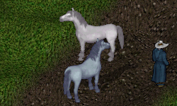
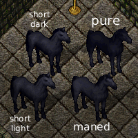
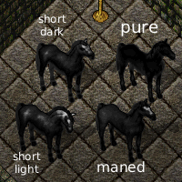

# Mounts
Mounts are [pets](/Pets) that speed up travel. Mounts do not go hungry nor lose happiness as long as they're being ridden.

Only the `Horse` can be purchased, other mounts must be tamed. [Animal Tamers](/Animal_Taming) can transfer pets to non-tamers, but only low-level creatures, and the recipient can only ride them, not control them. It is common practice for a tamer to issue a `follow` command on the recipient before transferring a tamed mount like an `Ostard`.
## Horse
Can be bought at any [Stable](/Stable) for `550` gold.

## Ridable Llama
Must say "ridable". Can be found in `The Lost Lands`.

## Ostard (Forest, Desert)
Can be found in `The Lost Lands` in their respective biomes. Forest Ostards come in reds, blues, and greens, Desert Ostards come in beige and brown.

## Ostard (Frenzied)
More stamina and stronger stats than their calmer cousins. Can be found east of `Delucia` near `Tortoise Lagoon`. Frenzied Ostards come in dark browns and yellows.

## Silver Steed
A Silver Steed can be found in the `Oasis` in `The Lost Lands`. Silver Steeds take up `1` follower slot and are essentially strong horses. There is a `1%` chance for a Silver Steed to be `shiny`, giving it an ice-white hue.

*shiny above, normal below*

## Nightmare
A Nightmare can be found in `Cyclops Valley` in `The Lost Lands`. Nightmares hit hard, use magic, and breathe fire like Dragons, making them definitively the strongest combat mount. However, they take up `2` follower slots.

Nightmares come in one of four styles based on mane and color: `Short Light`, `Short Dark`, `Maned`, and `Pure`. The two 'short-maned' styles look almost identical but are indeed two different styles. Each style has an equal chance to be chosen. 

 
*normal nightmares*

There is a `1%` chance for a Nightmare to be `shiny`, giving it a rare metallic hue on top of its random style.

*shiny nightmares*