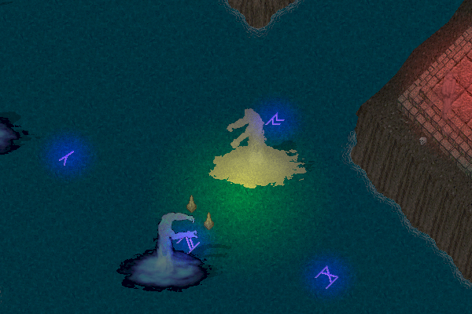

# Greater Elemental
The Greater Elemental is a demiboss that drifts in the lagoon on floor 4 of [Shame](/shame). Although nobody knows for certain where it came from, rumor has it that the mages themselves accidentally summoned it while experimenting with blood elementals. It hits softly, but it has an enormous health pool and fights beside an endless tide of lesser elementals. It is built for a group of players. After it dies, it returns `12` to `24` hours later.

## Fighting the Greater Elemental
- It has `20,000` to `30,000` hit points.
- It swims as well as walks, so it can follow players across the lagoon and onto its islands.
- If it strays more than `10` tiles from the center of the lagoon, it teleports straight back.
- Unlike other monsters, it walks around obstacles to reach its target.
- Its [Resisting Spells](/resisting_spells) is `100` to `110`.
- It never flees, however low its health.
- As a demiboss, its its melee hits and most of its spells do `100%` extra damage to [pets and summons](/follower#followers-in-combat), instead of the usual `25%`.

## Abilities
The Greater Elemental fights with standard Magery spells and a weak melee attack. Every `8` to `10` seconds in combat, it teleports up to `6` tiles away and summons an elemental beside it.

Each summon is a kind of elemental it doesn't already have:
- Above half health, it summons air, earth, fire, and water elementals.
- Below half health, poison and blood elementals join them, and it teleports twice as often.

It keeps at most one elemental of each kind. A slain elemental returns at its next teleport, and each one vanishes after `60` seconds. Its elementals swim, stay close to it when they have no target, and join its fight. Below half health the fight grows far more dangerous, because blood elementals hit nearly as hard as a dragon and most poison elemental hits carry lethal poison.

Its elementals are bound to it, so they leave no corpse and give no loot, fame, karma, summon scrolls, or skill gains.

## Loot
| Drop | Amount | Chance (%) |
|:-|:-:|:-:|
| Gold | 5,260 average | 100 |
| Weapons, armor, shields, and jewelry | 9 average | 100 |
| Gems | 100 | 100 |
| Reagents | 1,000 | 100 |
| Level 5 [treasure map](/treasure_map) | 1 | 100 |
| Primal amulet | 1 | 50 |

Most of the weapons, armor, and shields are magic, but jewelry never is. The gems are a random mix of every kind. The Magery reagents are randomly chosen and come in `10` stacks of `100`. As an elemental in Shame, the Greater Elemental also has a `25%` chance to drop one of the four elemental summon scrolls.

## Primal Amulet
A primal amulet is a gold necklace bound to one element: fire, air, earth, or water. The Greater Elemental drops one of a random element half the time.

While a primal amulet is worn, its element's summon spell costs no mana and no reagents. A primal amulet of fire, for example, makes [Summon Fire Elemental](/summon_fire_elemental) free. The free cast can only happen once every `10` seconds, whatever the amulet's element, and a fizzle doesn't count. Equipping it stops its wearer from putting on any primal amulet, including the same one, for `1` minute.

**A primal amulet may lose its power when its owner dies.** Every primal amulet a player carries, worn or in a bag, has a `50%` chance to become an ordinary gold necklace when they die, and its owner sees *The primal forces rescind their courtesy.*