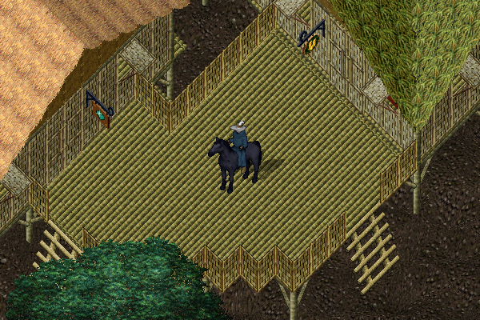

# Welcome
*Paradise* is an [Ultima Online](https://uo.com/) shard based on [T2A](https://en.wikipedia.org/wiki/Ultima_Online:_The_Second_Age), but era accuracy isn't the goal. Fun, interesting gameplay is. A paradise.

See [Shard Features](/features) for the major ways *Paradise* differs from T2A. See [Patch Notes](/patch_notes) for smaller and ongoing changes.

## The Basics
- This shard is designed for single players or cooperative groups.
- Players can't attack each other. Duel arenas and guild wars are the only PvP.
- Macroing is allowed, but macros that collect items or profit must be attended.
- New players are protected by the [Young](/young_player) player system.

## Accounts
- A **maximum** of `2` accounts are allowed per person.
- Each account can have `5` characters and `1` [house](/house).

## Decay
- [Houses](/house) decay after `90` days without a refresh, and everything inside is destroyed. 𐠒
- [Boats](/boat) sink `24` hours after their last refresh. 𐠒

## Conduct
- There is **zero tolerance** for bigotry and disruptive behavior.
- PvM etiquette is enforced and bullying isn't tolerated.