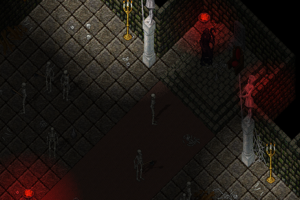

# Lich King
The Lich King is the first demiboss on *Paradise*, ruling from the throne room on floor 3 of [Covetous](/covetous). He is built for a group of players, though a strong player may be able to defeat him alone. After he dies, he returns `12` to `24` hours later.

## Throne Room
The throne room is populated by an army of skeletons, adding additional challenge to the fight. Further complicating things, a slain skeleton is replaced in the throne room within `30` seconds.

## Fighting the Lich King
- He has `5,000` to `6,000` hit points.
- His [Resisting Spells](/resisting_spells) is `150` to `200`, so he resists spells far more often than other monsters.
- Poison has no effect on him.
- He is undead, so [silver](/weapon#silver) weapons do double damage to him.

**The Lich King takes items from corpses near him, including fallen players.** He takes one item at a time from a corpse within `2` tiles, showing *\*rummages through a corpse and takes an item\**. Taken items drop with his own loot when he dies.

## Abilities
The Lich King fights mostly with spells, mixing Necromancy, which players can't learn, with Magery.

- Pain Spike: a sudden stab of pain at a single target.
- Poison Strike: poison bursts on the target and splashes anyone beside them.
- Wither: a wave of cold that hurts everyone around him.
- Strangle: chokes the target, hurting more the more tired they are.
- Blood Oath: binds a fighter, so their blows against him hurt them too for a while.
- Animate Dead: raises slain skeletons nearby to fight again.
- Magery: he also poisons, paralyzes, and drains mana from his foes.
- Healing: he heals himself now and then during the fight, and steadily whenever no one is in sight, so pulling him out of view gives him time to recover.

## Loot
| Drop | Amount | Chance (%) |
|:-|:-:|:-:|
| Gold | 5,260 average | 100 |
| 7th and 8th circle spell scrolls | 10 | 100 |
| Weapons, armor, shields, and jewelry | 9 average | 100 |
| Level 5 [treasure map](/treasure_map) | 1 | 100 |
| Silver weapon | 1 | 100 |
| Liche's ring | 1 | 10 |

Most of the weapons, armor, and shields are magic, but jewelry never is. The silver weapon is a random type of weapon, usually with magic properties.

## Liche's Ring
A liche's ring is a silver ring that turns a weapon silver. The Lich King has a `10%` chance to drop one, and every lich lord has a `0.1%` chance, even those outside of Covetous.

To use it, double-click the ring in the backpack and target a weapon in the backpack or in hand. Any weapon that isn't already silver can be converted, including bows and crossbows. The weapon becomes silver, takes on the silvery color, and loses any other slayer it had.

**Using a liche's ring kills its user.** The ring crumbles to dust, *The king sends his regards.* appears, and the user dies. The new silver weapon stays on the corpse.