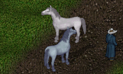
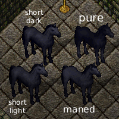
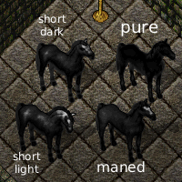

# Mount
Mounts are [pets](/pet) that speed up travel. Mounts don't get hungry or lose Loyalty while being ridden.

Only the horse can be bought; other mounts must be tamed. [Animal tamers](/animal_taming) can transfer pets to non-tamers, but only low-level creatures, and the new owner can only ride them, not command them. Tamers usually give the `follow` command to the new owner before transferring a tamed mount like an ostard.

## Horse
Horses can be bought at any [stable](/stable) for `550` gold.

## Ridable Llama
Ridable llamas are found in the Lost Lands. Look for a llama whose name says *ridable*.

## Forest and Desert Ostards
Forest and desert ostards are found in the Lost Lands, in their matching biomes. Forest ostards come in reds, blues, and greens, and desert ostards in beige and brown.

## Frenzied Ostard
Frenzied ostards have more stamina and stronger stats than their calmer cousins. They're found east of Delucia, near Tortoise Lagoon, and come in dark browns and yellows.

## Silver Steed
Silver steeds are found in the Oasis in the Lost Lands. A silver steed takes up `1` follower slot and is essentially a strong horse. There is a `1%` chance for a silver steed to be Shiny, giving it an ice-white hue.

Shiny above, normal below.

## Nightmare
Nightmares are found in Cyclops Valley in the Lost Lands. They hit hard, use magic, and breathe fire like dragons, making them the strongest combat mount by far. However, they take up `2` follower slots.

Nightmares come in one of four styles, based on mane and color: Short Light, Short Dark, Maned, and Pure. The two short-maned styles look almost identical, but they are two different styles. Each style is equally likely.

Normal nightmares.

There is a `1%` chance for a nightmare to be Shiny, giving it a rare metallic hue on top of its random style.

Shiny nightmares.
